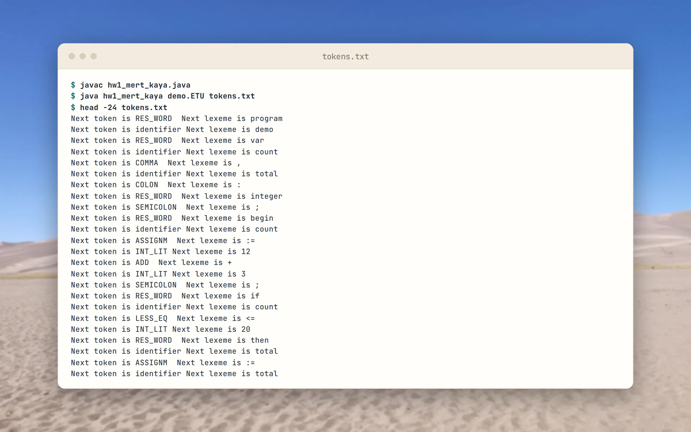
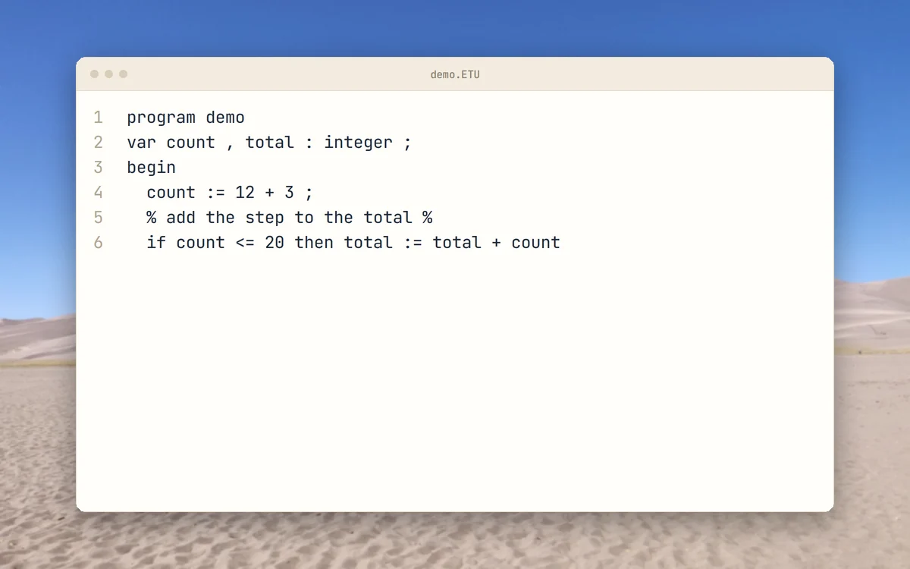
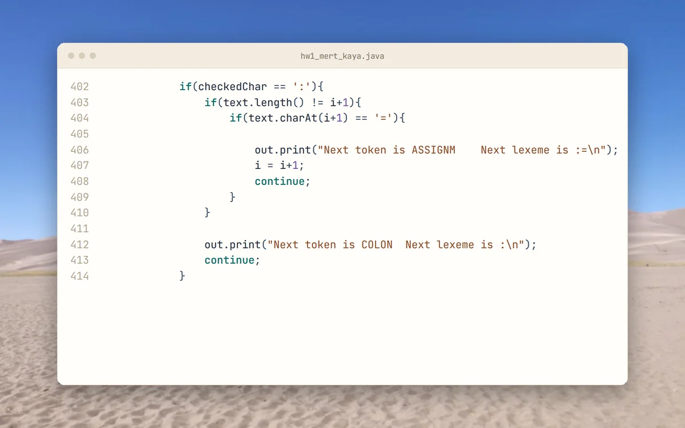
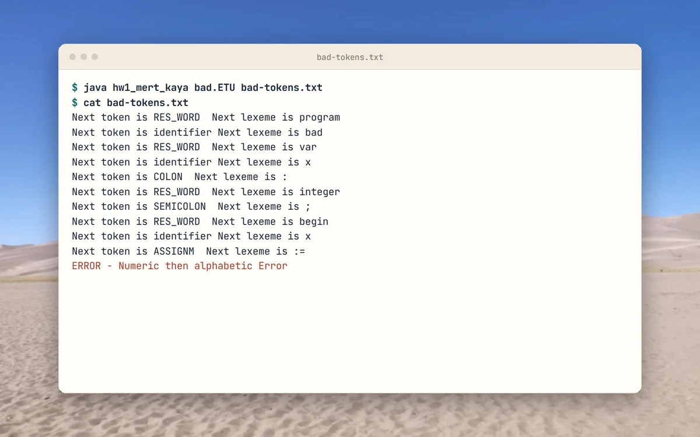
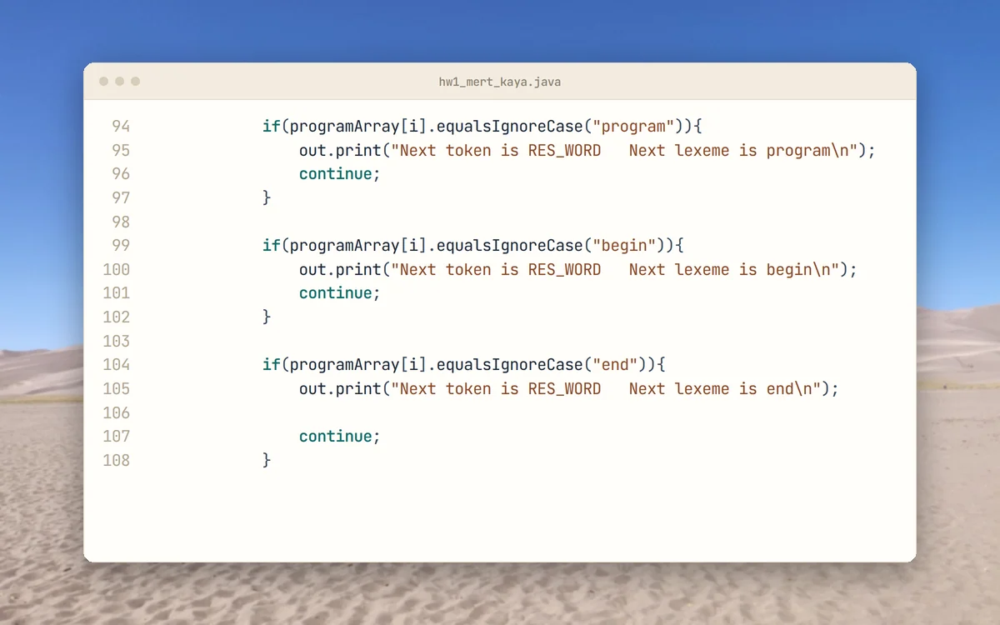

<p align="center">
  <picture>
    <source media="(prefers-color-scheme: dark)" srcset="docs/brand/svg/etulang-lexer-logo-on-dark.svg">
    
  </picture>
</p>

<h1 align="center">Read ETULang source. Print every token.</h1>

<p align="center">
  Archived homework for a Programming Languages course, 2021.<br>
  <b>One Java file. Nine reserved words. One token per line of output.</b>
</p>

<p align="center">
  
  <a href="LICENSE"></a>
  
  
  <a href="https://github.com/mertkayacs/ETULang-Lexical-Analyzer"></a>
</p>

<p align="center">
  <a href="#quick-start"></a>
  <a href="hw1_mert_kaya.java"></a>
  <a href="https://mertkayacs.com/?utm_source=github&utm_medium=readme&utm_campaign=ETULang-Lexical-Analyzer-repo&utm_content=portfolio-badge"></a>
</p>

<p align="center">
  <picture>
    <source media="(prefers-color-scheme: dark)" srcset="docs/assets/readme/hero-dark.webp">
    
  </picture>
</p>

ETULang Lexical Analyzer is a hand-written lexer for ETULang, a small teaching language from a Programming Languages homework. It reads a program from a file with the .ETU extension and writes one line per token to an output file. Reserved words, identifiers, integer literals, operators and punctuation each get their own token name. The whole analyzer is a single Java file of about 450 lines.

---

## Why ETULang Lexical Analyzer

The lexer stays small and each rule is easy to find in the source.

|  |  |
|---|---|
|  **Files in, tokens out** | Pass an .ETU file and an output file name. Each output line reads `Next token is RES_WORD` followed by the lexeme. |
|  **Nine reserved words** | program, begin, end, if, then, else, while, integer and var are matched without regard to case. |
|  **Comments are skipped** | A percent sign toggles comment mode, and everything inside a comment is ignored. |

## A quick tour

<table>
  <tr>
    <td width="50%" valign="top">
      <picture>
        <source media="(prefers-color-scheme: dark)" srcset="docs/assets/readme/tour/input-dark.webp">
        
      </picture>
      <h3>Sample program</h3>
      A small ETULang program with a variable declaration, an assignment, an if and a comment between percent signs.
    </td>
    <td width="50%" valign="top">
      <picture>
        <source media="(prefers-color-scheme: dark)" srcset="docs/assets/readme/tour/assign-dark.webp">
        
      </picture>
      <h3>Assignment token</h3>
      A colon followed by an equals sign becomes the assignment token. A lone colon becomes a COLON token.
    </td>
  </tr>
  <tr>
    <td width="50%" valign="top">
      <picture>
        <source media="(prefers-color-scheme: dark)" srcset="docs/assets/readme/tour/error-dark.webp">
        
      </picture>
      <h3>Error case</h3>
      A number followed by letters ends the analysis with an error line.
    </td>
    <td width="50%" valign="top">
      <picture>
        <source media="(prefers-color-scheme: dark)" srcset="docs/assets/readme/tour/source-dark.webp">
        
      </picture>
      <h3>Reserved words</h3>
      The first reserved-word checks in hw1_mert_kaya.java, matched without regard to case.
    </td>
  </tr>
</table>

<p align="center"><sub>The sample programs were written for this tour. The terminal card shows real output of the analyzer, and the code cards show files as they are in the repository.</sub></p>

## Features

**Tokens**

- RES_WORD, identifier and INT_LIT.
- ADD, SUBT, MULT and DIV, plus ASSIGNM for :=.
- COLON, SEMICOLON, COMMA, LPARANT and RPARANT.
- LESS, LESS_EQ, GREATER, GRE_EQ and NOTEQ.
- UNKNOWN for any other character.

**Checks**

- The input file name must end in .ETU, otherwise the output file says so.
- A number followed by letters is reported as an error.

## Quick start

```sh
javac hw1_mert_kaya.java
java hw1_mert_kaya program.ETU tokens.txt
```

The first argument is the input program and the second is the output file. The repository holds no sample program, so write one with the reserved words above.

### Requirements

- Java 11 or newer. The code calls `String.isBlank()`, which Java 11 added.

## FAQ

<details>
<summary><b>What is ETULang?</b></summary>

A small teaching language from the Programming Languages homework. The repository holds the lexer only and does not define the grammar.
</details>

<details>
<summary><b>Which Java version do I need?</b></summary>

Java 11 or newer, because of String.isBlank().
</details>

<details>
<summary><b>Where does the output go?</b></summary>

Into the file named by the second argument, one token per line.
</details>

If ETULang Lexical Analyzer is useful to you, a ⭐ helps other people find it.

## License

[MIT](LICENSE).

[](https://github.com/mertkayacs/ETULang-Lexical-Analyzer)
